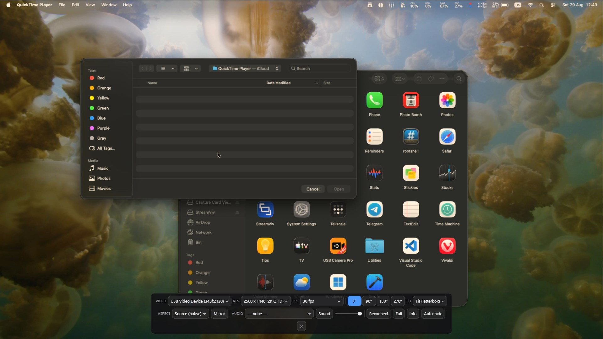
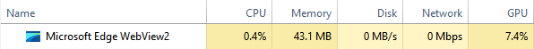

# StreamViv

StreamViv is a fast, lightweight viewer for USB capture cards. It gives you a
clean live preview without the overhead of OBS or a full broadcast suite.

<!-- Hero Screenshot -->
<p align="center">
  
</p>

<!-- Secondary Feature / Performance Showcase -->
<p align="center">
  
  <br>
  <sub><i>Low GPU & Resource Overhead</i></sub>
</p>

## What is StreamViv

**StreamViv** is a lightweight, cross-platform video capture viewer designed for high performance, ease of use, and developer-friendly maintainability.

* **Ultra-Lightweight & Cross-Platform Architecture**
Built on **Svelte** and **Tauri 2**, StreamViv delivers the modern UI responsiveness of web technology without the high memory and CPU overhead of traditional Electron apps.
* **Native "Zero-Setup" Capture Readiness**
The app handles low-level OS permissions natively under the hood—such as injecting `Info.plist` details directly into binaries on macOS and managing GTK/WebKit permission signals on Linux—so video capture devices work seamlessly right out of the box.
* **Deep Headless & CI-Friendly Tooling**
Includes specialized build scripts (like `package-macos.sh` via `hdiutil`) that circumvent platform limitations—allowing full `.dmg`, `.deb`, `.rpm`, `.AppImage`, and `.exe` packaging in headless CI/CD environments and Docker/Podman containers without requiring dedicated host hardware.
* **Smart Hardware & Driver Workarounds**
Includes automatic runtime platform fixes—such as detecting problematic NVIDIA + X11 driver combinations on Linux and automatically toggling renderer flags (`WEBKIT_DISABLE_DMABUF_RENDERER`) to prevent blank-screen rendering crashes.
* **Built-in Self-Diagnostics (`bun run doctor`)**
Features a dedicated "Doctor" script (`scripts/doctor.sh`) designed to instantly diagnose missing system dependencies, media framework plugins (e.g., GStreamer v4l2), or missing user privileges (such as the Linux `video` group) before launch.
* **Zero-Dependency Universal Testing**
Employs a custom, runner-agnostic test harness built on native `node:assert`. Developers can run unit, end-to-end, and cross-platform simulation tests using standard Node.js or Bun without needing specialized external frameworks.

### How to Install & Run

Visit the StreamViv Releases page and download the build for your platform:

* **Windows:** Run the setup installer (`StreamViv_..._x64-setup.exe`) or open the portable executable (`streamviv.exe`) directly without installation.
* **macOS:** Install using the disk image (`.dmg`) or unpack the standalone app archive (`.zip`).
* **Linux:** Choose an installer (`.deb` / `.rpm`), use the portable `.AppImage`, or run the raw binary executable (`streamviv`).

## Run from source

```sh
bun install
bun run app:dev
```

Build a release:

```sh
bun run app:build
```

See [BUILDING.md](BUILDING.md) for platform-specific build instructions.

## License

See [LICENSE](LICENSE).
